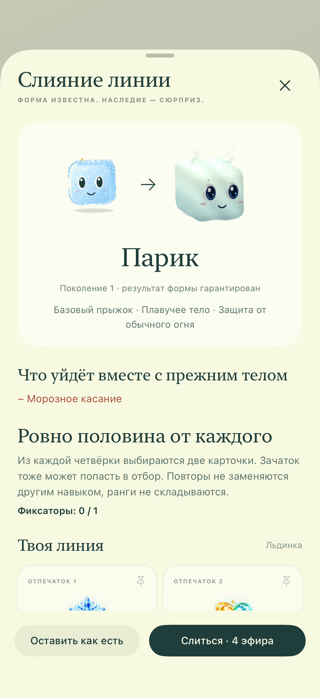
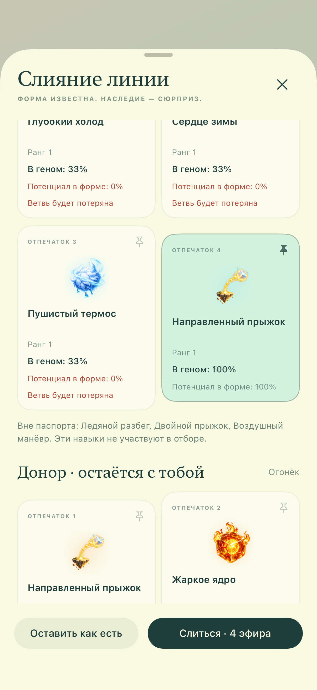
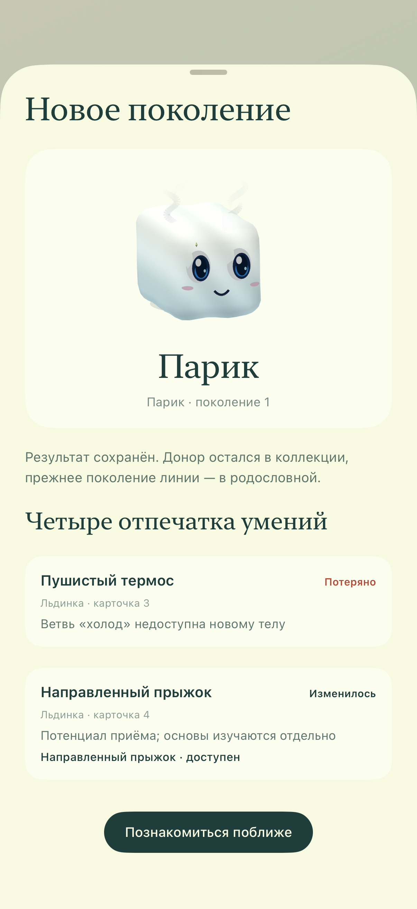
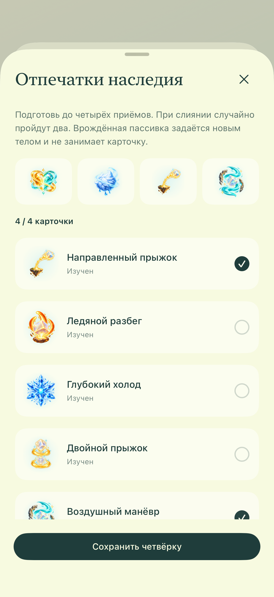

# Альфа 14 — наследие текущей формы

Оригинальные снимки работающего Release-приложения из XCTest, не макеты. Для Apple PNG переведены в RGB без изменения размера или RGB-пикселей. [Происхождение и SHA-256](manifest.json) · [Проверки](../../docs/QA-ALPHA14.md) · [Аудит исходного ТЗ](../../docs/SPEC-AUDIT.md).

| Подготовка: форма и потери | Вероятности и фиксатор |
| --- | --- |
|  |  |

| Сохранённый результат | Личный паспорт |
| --- | --- |
|  |  |

iPhone: 1206 × 2622. iPad Pro 13″ M4: 2064 × 2752, [подготовка](ipad-13-preparation.png) и [результат](ipad-13-result.png). Отбор в проверочной сцене использует настоящий алгоритм, поэтому конкретные выпавшие карточки на разных снимках могут отличаться. Квоты и закреплённый приём одинаковы.

Локальный запуск примера: `--preview-metamorphosis --ui-testing`. В обычное сохранение тестовые ресурсы не записываются. Автоматическая пассивка бесплатна, развитие пока состоит из зачатков; картинка не означает наличие обучения бота или полной паровой физики.
