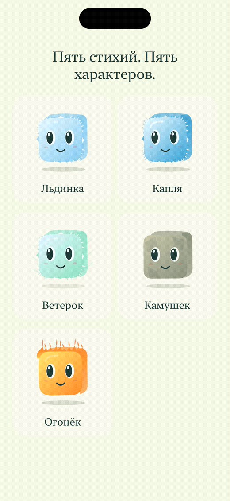

# Альфа 9 — нативные снимки и анимация

Снимки iPhone 16 Pro (1206 × 2622) и iPad Pro 13″ M4 (2064 × 2752), Release, iOS 26.5 Simulator. Размер и RGB-пиксели захвата сохранены; удалён только альфа-канал PNG.

- [Лёд и главная](iphone-ice.png) · [дерево](iphone-skills.png) · [снаряжение](iphone-equipment.png) · [пунктир без стрелки](iphone-gesture.png).
- [Дерево iPad](ipad-13-skills.png) · [лёд iPad](ipad-13-ice.png).
- [Удар ящика по воде](iphone-splash.png) — реальное физическое состояние, полученное последовательным расчётом шагов.
- [Галерея пяти портретов](iphone-portraits.png) и [анимированная запись](portraits.gif) — служебный режим визуальной проверки, в обычной навигации его нет. Эти материалы не загружаются в карточку Apple как игровой экран.

Начальный монстр знает одну пассивку из семи узлов. В сцене прицеливания направленный прыжок изучен только для служебного предпросмотра. Обычный запуск не выдаёт его автоматически. [Проверки](../../docs/QA-ALPHA9.md) · [Физика](../../docs/PHYSICS.md).
