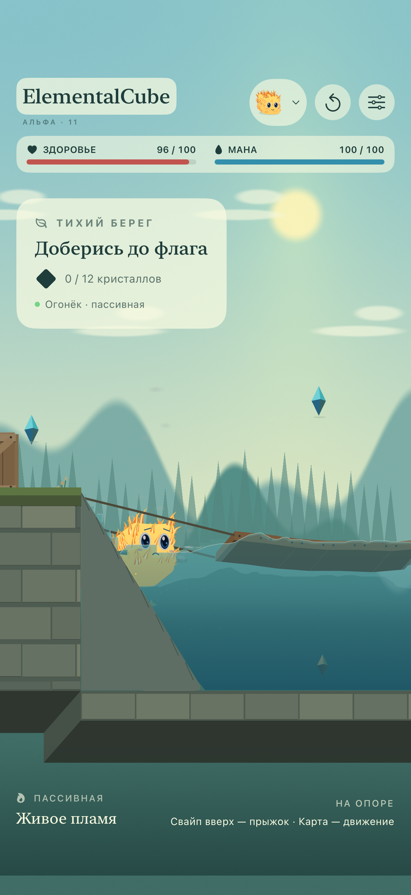

<h1 align="center">ElementalCube</h1>

<strong>Маленький куб. Большой мир.</strong> iPhone · iPad · Mac · ранняя альфа

**Физическая песочница с маленькими живыми стихиями.** Выбери первого друга или создай случайного, исследуй три разных маршрута, развивай его навыки, выращивай и объединяй кубиков.

**Альфа 0.1.0 (11) доступна во внутреннем TestFlight.** Обновление объединяет объёмный вид персонажа в мире и меню и добавляет главный экран, выбор первого кубика, коллекцию, эволюцию, мердж, три карты и новое управление. [Фактический статус TestFlight](docs/TESTFLIGHT.md) · [Ссылка для внешних тестеров](https://testflight.apple.com/join/snm99FQh) · [Карточка Apple](docs/APP_STORE_CARD.md).

## Вода в обновлении 12

Капля — гладкий куб из воды с мягкими углами, без шерсти, в меню и на карте. Обновлены перенос жидкости у предметов, выделение мелких капель и непрерывная поверхность; прозрачные пластины за волной удалены. Испарение забирает реальный объём вокруг источника и не оставляет ложных ячеек давления. [Разбор и источники](docs/PHYSICS.md#сборка-12-поверхность-и-перенос-воды) · [Проверки 12](docs/QA-ALPHA12.md) · [Нативные снимки](Previews/alpha12).

## Как играть

- **Свайп вверх по игровому экрану** — бесплатный базовый прыжок. Небольшой наклон слегка направляет его.
- **Касание или движение пальцем по карте** — кубик движется к выбранной точке; новое касание меняет направление.
- **Касание и поглаживание кубика** — радость, мимика и сердечки.
- **Удержание кубика и перетягивание** — прицельный прыжок, только после изучения. Начальный предел 8 м/с (у воздуха 8,4), усиления открываются в личном дереве. Траекторию показывает пунктир без стрелки.
- **Повторный свайп в воздухе** — один дополнительный толчок, если изучен двойной прыжок.

В начале известна только пассивка. Она всегда бесплатна и уже занимает свой слот. Базовый прыжок не требует изучения. Направленный прыжок расходует 6 маны, воздушный толчок — 10; мана восстанавливается. На Mac работают те же жесты мышью, стрелки/A–D и пробел.

## Пять стихий и свои движения

| Кубик | Движение и пассивка |
| --- | --- |
| Льдинка | Скользит с коротким морозным следом. Вода сразу становится опорой, затем лёд постепенно растёт в стороны и вниз. |
| Капля | Подпрыгивает маленькими скачками, плавает и физически сплющивается для прохода вдвое ниже обычного кубика. После выхода распрямляется; масса сохраняется. |
| Ветерок | Парит и скользит над сушей и водой, оставляя воздушный след. |
| Камушек | Катится настоящим вращением тела, тонет и проходит по дну. Шерсти нет. |
| Огонёк | Перетекает с живым пламенем, сжигает траву и дерево, оставляет обугленный след. Испаряет воду за здоровье. |

Кубики дышат, моргают, смотрят по сторонам, радуются поглаживанию и находкам. Шерсть есть у ледяного тела: на передней грани и контуре она реагирует на ветер, намокание, движение и посадку. Вода — гладкая капля, воздух окружён завихрениями, огонь покрыт изогнутыми язычками по всему телу. Мягкий голубой портрет Льдинки сохранён. Для остальных стихий меню использует объёмную модель и соответствующие материалы. Камень и огонь невосприимчивы к огню; остальные формы могут загореться и потушиться в воде. Живые портреты работают и при остановленной игре.

## Друзья, навыки и эволюция

Первый выбор бесплатный: пять стихий или случайное имя и облик. После начала смена уже имеющегося друга стоит **2 эфира**, новый — **4**. Каждый кристалл мира приносит эфир один раз для всего профиля; первое прохождение каждой карты — ещё **6**. Перезапуск не создаёт валюту повторно.

У каждого кубика собственные находки, дерево, талисман и материалы. За первую личную находку кристалла он получает очко навыка. Эволюция имеет три ступени: нужны 3/6/9 разных находок и 4/8/12 эфира. Личность и изученные навыки сохраняются, внешность и предел прицельного прыжка растут.

**Мердж стоит 4 эфира и превращает двух выбранных друзей в одного потомка.** Перед действием показано подтверждение. Материалы и свободные очки суммируются, каждый известный приём имеет 50% шанс передачи от каждого родителя. Новый кубик получает собственный UUID, родословную, цвет, анимацию и дерево. Десять пар разных стихий дают пар, лаву, гейзер, кристалл, снежок, глину, искры, метель, туман и пыль; одинаковые стихии создают резонанс.

[Инвентарь и правила наследования](docs/INVENTORY.md) · [Анимация](docs/AVATARS.md).

## Три карты

**Тихий берег** — вода, шарнирный подвесной мост, физический ящик, западные террасы и нижний пещерный путь. **Хрустальные высоты** — ледяные ступени и подъём к облакам. **Сад тёплых искр** — огоньки, деревянные площадки и глубокий восточный спуск. У каждой карты свои коллайдеры, 12 кристаллов, финиш и первая награда. Границы мира 112 × 52 м; камера движется по обеим осям. В низком проходе водная форма может просочиться, остальные используют верхний путь.

## Физика

Box2D 3.1.1 считает столкновения, массу, вращение ящика, шарниры и тросы моста на 120 Гц. PIC/FLIP-жидкость обменивается импульсом с телами; капли брызг несут часть воды и возвращаются в водоём, пена следует течению. Лёд забирает массу из воды, растёт постепенно и возвращает её без старого импульса при таянии. Толстая корка живёт дольше тонкой. Огонь поджигает только траву и дерево при контакте, оставляя постепенное обугливание самих поверхностей. В воде появляются локальные пузырьки, пар и циркуляция; кипение не начинается при пролёте над прудом.

Это игровая модель в плоскости XY с объёмным изображением. Полная трёхмерная жидкость, свободные ледяные обломки и точная термодинамика не моделируются. [Подробности и ограничения](docs/PHYSICS.md) · [Проверки обновления 10](docs/QA-ALPHA11.md).

## Запустить

На Mac: `./scripts/run-mac.sh`. На iPhone/iPad: открой `ElementalCube.xcodeproj`, схема `ElementalCube-iOS`. [Разработка](docs/DEVELOPMENT.md).

Игра работает без регистрации, рекламы, покупок и игрового сервера. Настройки, коллекция, валюта, навыки и предметы сохраняются на устройстве. [Конфиденциальность](docs/PRIVACY.md). CI/CD не используется; сборки и публикация запускаются локально. [Архив альфы 9](Previews/alpha9).

## Лицензия

**Copyright (c) 2026 Sergii Ziborov. All rights reserved.** Собственный код и материалы под [закрытой лицензией](LICENSE): публичный доступ не даёт разрешения на использование, изменение и распространение без письменного разрешения правообладателя. Просмотр и форки внутри GitHub регулируются условиями сервиса.

Box2D сохраняет MIT. [Сторонние компоненты](THIRD_PARTY_NOTICES.md).
