

  

<h1 align="center">ElementalCube</h1>

<strong>Маленький куб. Большой мир.</strong>

iPhone · iPad · Mac · ранняя альфа

**ElementalCube — физическая песочница для iPhone, iPad и Mac.** Выберите одну из пяти стихий, исследуйте тихий берег. Доберитесь до флага, соберите двенадцать кристаллов, а каменным кубом найдите реликвию под водой.

Короткий тап по кубику — обычный прыжок вверх. Коснитесь карты или ведите по ней пальцем — куб покатится, поплывёт или заскользит к выбранной точке. После изучения направленного прыжка потяните самого куба в сторону полёта и отпустите: пунктир без стрелки показывает траекторию. Двойной прыжок также открывается в личном дереве. Кубик смотрит по направлению движения, радуется находкам, реагирует на жёсткую посадку и встряхивает мокрую шерсть.

**Альфа 0.1.0 (9) доступна во внутреннем TestFlight.** Живые портреты, бесплатные пассивки, изучаемые приёмы, постепенный лёд, брызги и горение. [Статус TestFlight](docs/TESTFLIGHT.md) · [Публичная ссылка](https://testflight.apple.com/join/snm99FQh). Игра работает без регистрации, рекламы и игрового сервера.

[Материалы для карточки Apple](docs/APP_STORE_CARD.md) · [Новая шерсть: сухая и мокрая](Previews/fur5) · [Конфиденциальность](docs/PRIVACY.md)

## Управление, инвентарь и мир

Пассивки и обычный прыжок бесплатны. Изначально известна только пассивка; новые приёмы изучаются в дереве. Кнопок движения и прыжка на экране нет. Касание карты сохраняет точку назначения; новый жест меняет её. Прицеливание начинается только на самом кубе. Направление совпадает с движением пальца во всех четырёх квадрантах; слабый жест даёт слабый толчок, длинный достигает предела навыка. Во время прицеливания мир и камера фиксируются. На Mac мышь работает так же; клавиатура сохранена.

Карта выросла с 28 × 13 до **112 × 52 м** без увеличения размера куба. Старый берег остался на месте; к западу идут высокие террасы, к востоку — спуск по скальным уступам, внизу — пещерный путь. Камера следует по обеим осям. В мире 12 кристаллов, прежняя арка стала промежуточным ориентиром, финиш переместился в нижнюю восточную часть.

Кнопка стихии открывает **личный инвентарь выбранного монстра**: дерево навыков, слот талисмана и материалы. Изученные узлы меняют реальную физику и расход ресурсов. У каждого куба свой прогресс; кристалл приносит очко только при первом сборе этим владельцем. Типы имеют разные ветки пассивок. Стартовый каменный оберег можно надеть и снять; каменная форма может добыть другой талисман под мостом. Дерево состоит из двух связанных ветвей с круглыми узлами и цветом стихии. Нажатие открывает отдельную карточку с описанием, условиями и стоимостью изучения. [Устройство инвентаря](docs/INVENTORY.md).

Первая ледяная корка появляется сразу. Пока Льдинка стоит, корка утолщается вниз; рост замедляется с толщиной, а холод постепенно проходит в соседние участки. Верх льдины не скачет при перестройке коллайдера. Замороженная масса возвращается при таянии без сохранённого старого импульса. [Физика](docs/PHYSICS.md).

  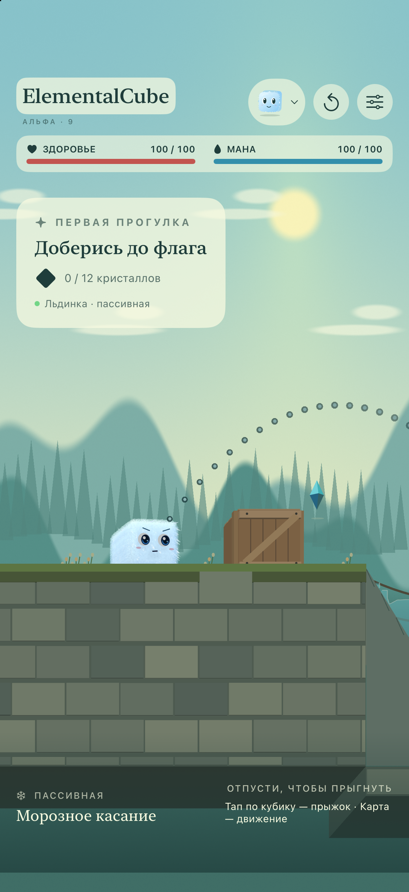
  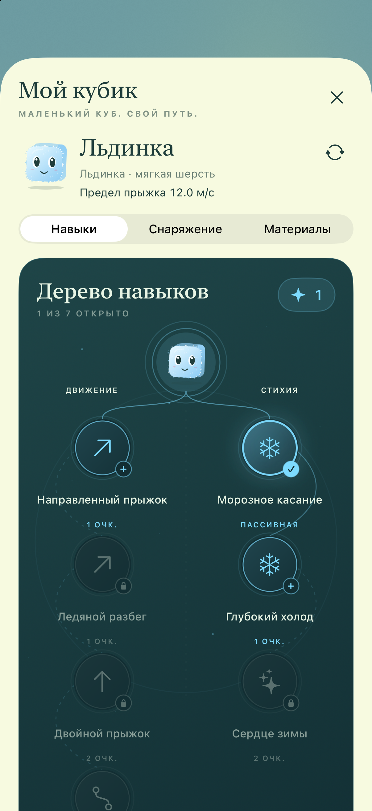
  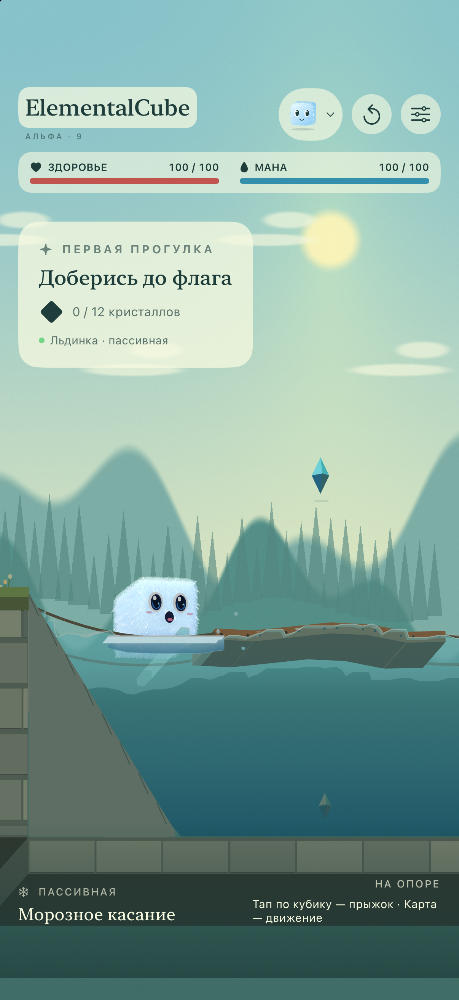

[Новые снимки iPhone и iPad](Previews/alpha9) · [Проверки](docs/QA-ALPHA9.md) · [Архив альфы 7](Previews/gestures7)

## Обновление 9: живой кубик, вода и изучаемые приёмы

Монстрик анимирован на главном экране, в инвентаре, дереве, паузе и результате: дышит, моргает, смотрит по сторонам и реагирует на поглаживание. У пяти стихий разный характер движений; камень без шерсти, огонь с живым пламенем. Портреты продолжают двигаться при открытом меню. [Анимация](docs/AVATARS.md).

Изначально известна только бесплатная пассивка. Обычный прыжок коротким тапом — базовое бесплатное действие. Направленный прыжок нужно изучить; двойной открывает один дополнительный толчок в воздухе. Активные приёмы расходуют ману, пассивки — никогда. Старые оплаченные улучшения сохраняются.

Лёд распространяется постепенно расширяющейся кромкой и утолщается вниз; толстый слой тает дольше тонкого. Капли брызг несут реальную часть воды, летят под гравитацией и возвращаются в водоём, пена движется с течением. Водная, ледяная и воздушная формы могут загореться; огонь и камень невосприимчивы, погружение тушит возгорание.

  
  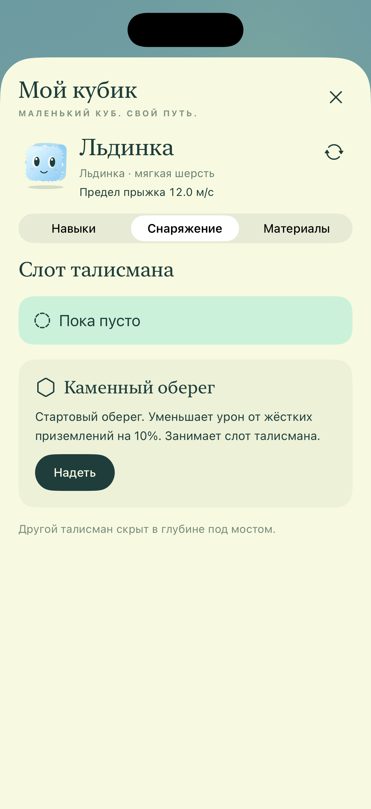

[Проверки обновления 9](docs/QA-ALPHA9.md) · [Архив обновления 8](Previews/skills8)

## Вода и предметы

Ящик падает, вращается, сталкивается с кубом и вытесняет воду. Деревянный мост состоит из шести физических секций, соединённых шарнирами и закреплённых тросами на берегах: он провисает, качается и реагирует на вес героя. У всех объёмных предметов закрыты нижние грани.

Вода движется частицами через сетку давления PIC/FLIP. Движение предмета передаётся воде, а давление воды — предмету с учётом массы и вращения. Волны и поверхность получаются из расчёта жидкости. Вода доходит до берегов и обволакивает погружённые предметы.

Льдинка при первом касании сразу замораживает под собой тонкую опору. Дальше лёд постепенно растёт в стороны и вниз. Вода и лёд сохраняют общий объём. Начальная пассивная способность уже назначена; нажатие на её название открывает описание. Улучшения доступны в личном дереве навыков.

  
  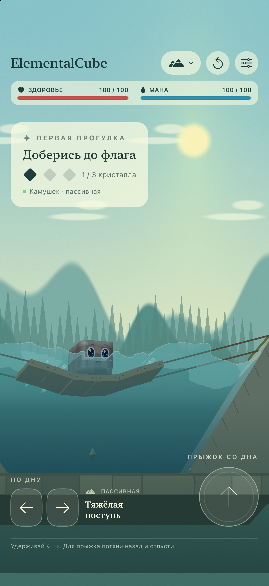
  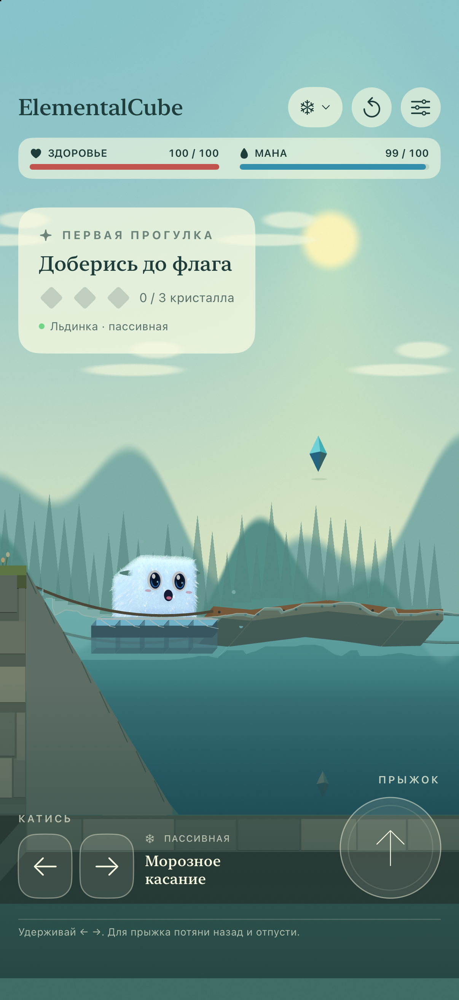

[Как устроена физика](docs/PHYSICS.md) · [Снимки сборки 6](Previews/physics6)

## Мягкая шерсть в сборке 5

У кубика появился плотный короткий подшёрсток и мягкие изогнутые пучки по контуру. Шерсть покрывает переднюю грань, оставляя глаза и рот открытыми. Ветер укладывает пучки, а вода прижимает и затемняет ворс. Камень остаётся без шерсти, у огня — пламя.

  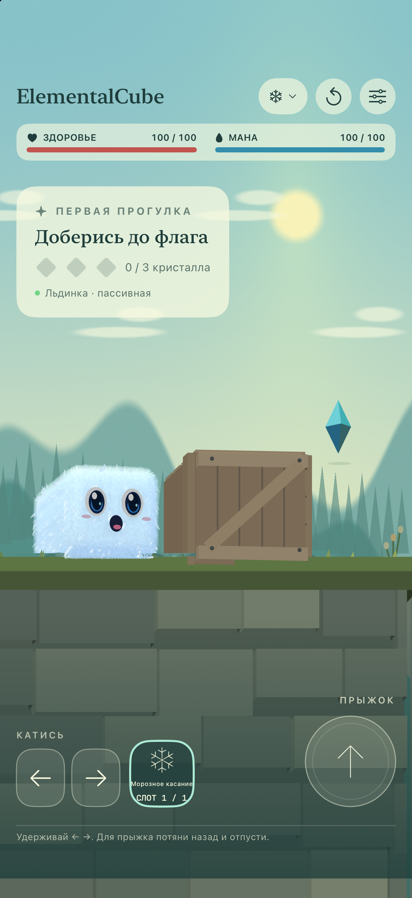
  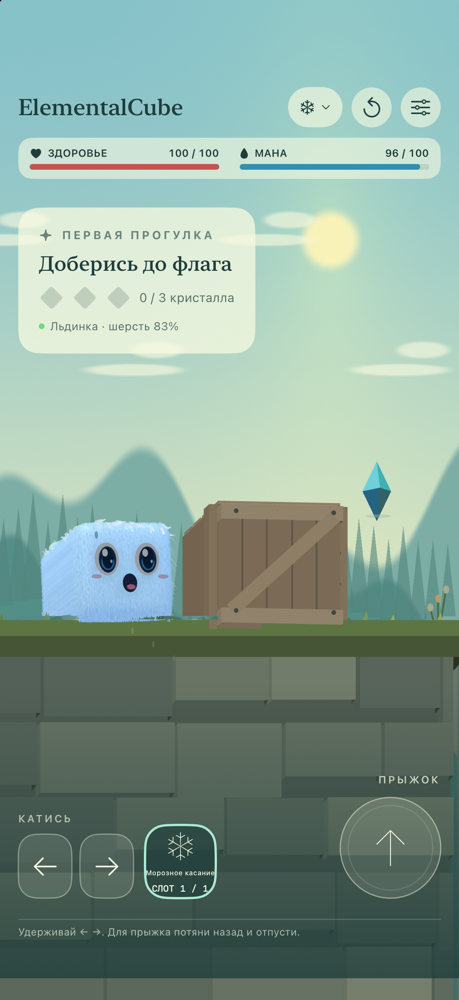

[Снимки сборки 5](Previews/fur5) · [Устройство шерсти](docs/FUR.md). Галерея пяти форм ниже показывает предыдущую альфу 4.

## Пять стихий

| Форма | Тело и движение | Начальная пассивная способность |
| --- | --- | --- |
| ❄️ Льдинка | Пушистая, катится и сразу создаёт ледяную опору | После первой опоры мороз постепенно растёт от касания в стороны и в глубину; длительная стоянка утолщает корку; иней делает поверхности скользкими |
| 💧 Капля | Водная шерсть намокает, тело плавает | Волна облегчает плавание |
| 🌬 Ветерок | Скользит без качения | Воздушная подушка поддерживает над сушей и водой |
| 🪨 Камушек | Тяжёлый, без шерсти, тонет | Устойчивость помогает двигаться по дну через подводный проход |
| 🔥 Огонёк | Пламя вместо шерсти | Сжигает траву и ящик, оставляет уголь, испаряет воду с потерей здоровья |

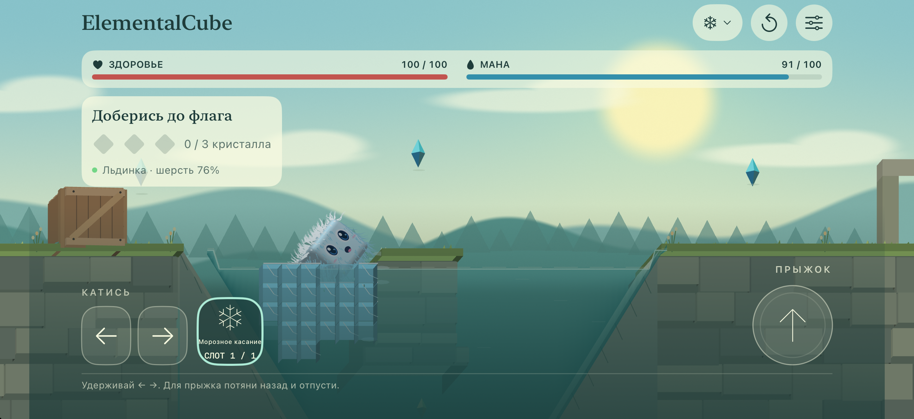

Мороз действует локально, а льдины получают настоящие коллайдеры. Новая льдина не появляется внутри куба или ящика. Вдали от холода лёд медленно тает — полностью охлаждённая льдина живёт около 30 секунд после ухода.

  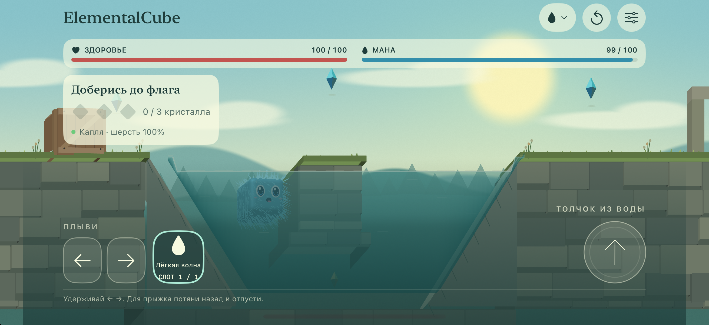
  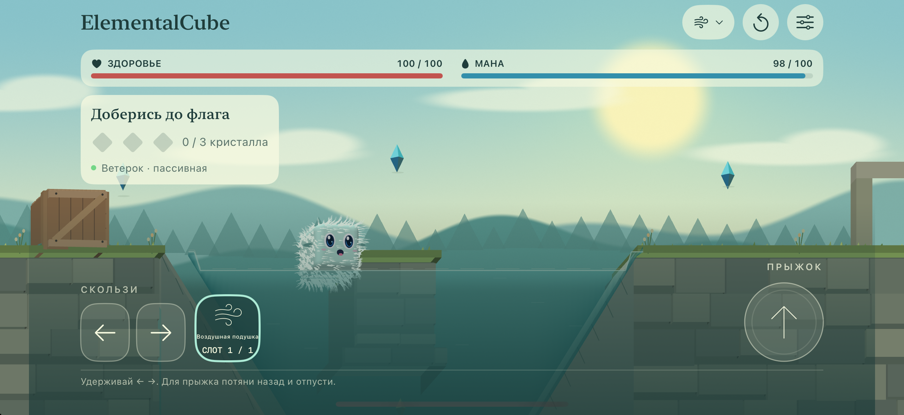

  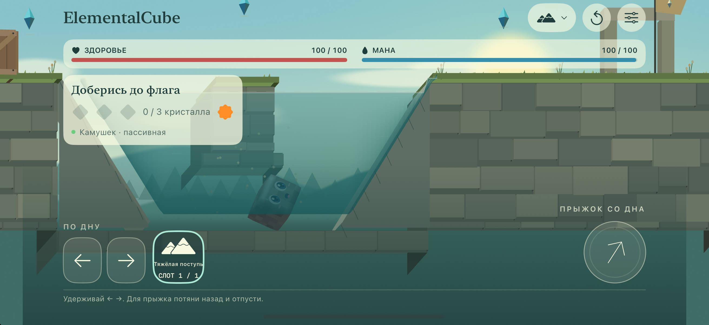
  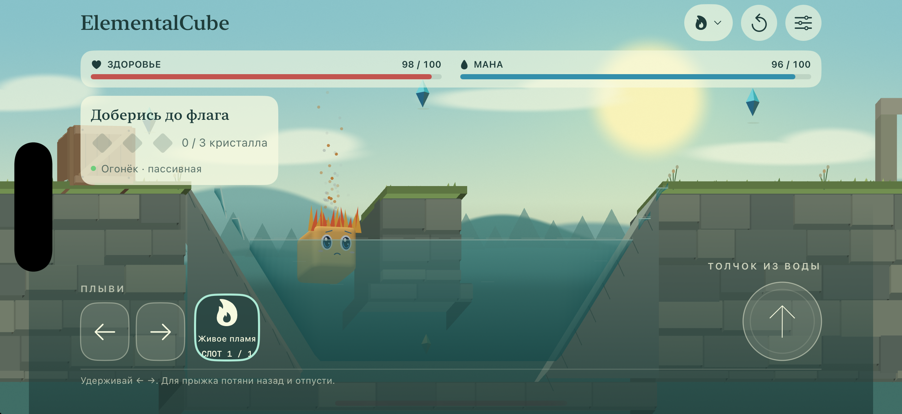

**Начальные пассивные способности уже назначены.** Название открывает только описание; включать и выключать способность на игровом экране нельзя. Здоровье и мана видны сразу. При истощении маны дальнейшее действие восстанавливается после 20 единиц; первая ледяная опора остаётся доступна. Смена формы начинает новую попытку и восстанавливает мир.

## На iPhone и iPad

Новые нативные снимки интерфейса и игры в [альфе 8](Previews/skills8). В карточке Apple размещены четыре новых снимка iPhone на каждом языке и снимок ледяной физики iPad 13″ из сборки 7. Архив пяти форм сборки 4 сохранён [отдельно](Previews/alpha4).

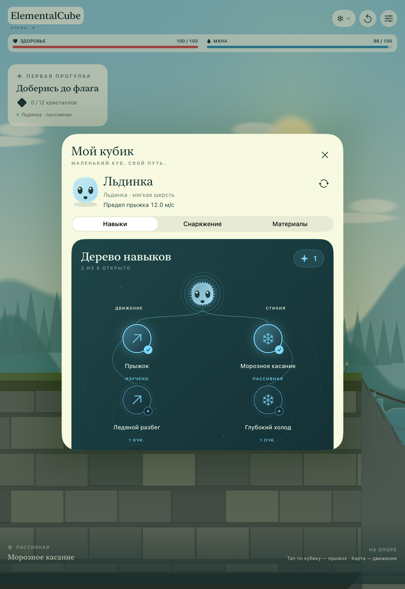

## Что уже можно почувствовать

- **Прыжок и инерция.** Направление и сила задаются жестом; пунктирная дуга показывает будущий полёт. Короткое касание самого куба даёт один обычный прыжок вверх; удержание без движения и отменённое прицеливание не прыгают.
- **Материалы и инерция.** У форм различаются плотность, плавучесть, трение и способ движения. Ящик можно толкать, заморозить и сжечь; камень тонет, воздух скользит.
- **Разные поверхности.** Трава смягчает посадку, камень встречает жёстче, лёд позволяет скользить. На поддерживаемых iPhone ощущения дополняет вибрация.
- **Кубик с характером.** Мимика, моргание, взгляд, сжатие перед прыжком и капли. Пряди на всех шести гранях, включая переднюю, изгибаются от ветра, движения и контактов; намокание меняет сопротивление и слипание.
- **Удобные настройки.** Чувствительность жеста, гравитация, масштаб камеры и вибрация сохраняются между запусками.
- **Обе ориентации.** Портретный и горизонтальный режимы на iPhone и iPad; незавершённый жест отменяется при повороте или уходе в фон.

## Управление

| Действие | iPhone / iPad | Mac |
| --- | --- | --- |
| Катиться, плыть или скользить | Коснуться карты / вести пальцем | Щёлкнуть по карте / вести мышью; также ← / →, A / D |
| Обычный прыжок | Короткий тап по кубику | Короткий щелчок по кубику или пробел |
| Направленный прыжок | Потянуть самого куба в сторону полёта и отпустить | То же мышью; пробел — вертикальный прыжок |
| Пассивная способность | Название способности → описание | F → описание |
| Инвентарь, дерево, предметы | Кнопка стихии сверху | Та же кнопка |
| Начать карту заново | Кнопка перезапуска | R |
| Пауза | При уходе в фон | Esc |

Направление жеста прямое; переключатель рогатки убран. В воздухе дополнительного прыжка нет. Короткий запас 0,1 с после схода с опоры сглаживает контакты при качении; он не позволяет повторный прыжок. Толчок в воде доступен без твёрдой опоры.

## TestFlight и карточка Apple

[Карточка ElementalCube](https://appstoreconnect.apple.com/apps/6822921592/testflight) заполнена. Сборка 6 прошла валидацию и обработку Apple и доступна внутренней группе. Внешняя отправка пока не принята: сборка 4 той же версии ещё находится на Beta App Review; [ссылка для тестеров](https://testflight.apple.com/join/snm99FQh) откроет установку после допуска. Публичный релиз App Store не отправлялся. [Точный статус](docs/TESTFLIGHT.md).

| Поле | Значение |
| --- | --- |
| Platform | iOS — одно приложение для iPhone и iPad |
| Name | `ElementalCube` |
| Primary language | Russian |
| Bundle ID | `com.weavatrix.elementalcube` |
| SKU | `ElementalCube-iOS` |
| User Access | Full Access |
| Версия после создания | `0.1.0` |
| Категория | Games → Puzzle / Adventure |

Русское и английское описания, подзаголовки и задания сборки 6 сохранены в Apple. В карточке сохранены 10 обработанных Apple снимков альфы 6. [Тексты карточки](docs/APP_STORE_CARD.md) · [Иконка 1024 × 1024](Resources/Assets.xcassets/AppIcon.appiconset/AppIcon.png) · [Снимки физики сборки 6](Previews/physics6).

## Куда развивается игра

Исходники загруженной альфы 8 закреплены тегом `v0.1.0-alpha.8`. Предыдущие подписанные альфы 5, 4 и 2 закреплены под своими тегами. Пять стихий, здоровье и мана, начальные пассивные способности, конечный объём воды, горючие материалы и физические пряди описаны в [правилах механик](docs/ELEMENTS.md).

Сейчас доступны одна карта и пять форм. Обучение кубика, эволюция, арены и сохранение прохождения ещё не реализованы. Сохраняются настройки, выбранная форма и её личные навыки, находки и снаряжение.

Физика рассчитана на игру в 2,5D: твёрдые тела обрабатывает Box2D, вода использует частицы и сетку давления PIC/FLIP с взаимным обменом импульсом с предметами, шерсть — пряди с ограничениями длины. Это игровая модель; полноценная трёхмерная жидкость и свободно плавающие ледяные осколки ещё не реализованы. Производительность и вибрацию на физическом iPhone нужно проверить отдельно.

## Запустить и проверить

На Mac: `./scripts/run-mac.sh`. Для iPhone и iPad откройте `ElementalCube.xcodeproj` и выберите схему `ElementalCube-iOS`.

[Сборка и устройство проекта](docs/DEVELOPMENT.md) · [Проверка альфы 8](docs/QA-ALPHA8.md) · [TestFlight](docs/TESTFLIGHT.md)

CI/CD нет. Сборки и проверки запускаются локально.

## Лицензия

**Copyright (c) 2026 Sergii Ziborov. All rights reserved.** Собственный код и материалы игры распространяются под [закрытой лицензией](LICENSE); публичный доступ не даёт разрешения на их использование, изменение и распространение без письменного разрешения правообладателя. Просмотр и форки внутри GitHub регулируются условиями сервиса.

Box2D сохраняет лицензию MIT. [Сторонние компоненты](THIRD_PARTY_NOTICES.md).
