
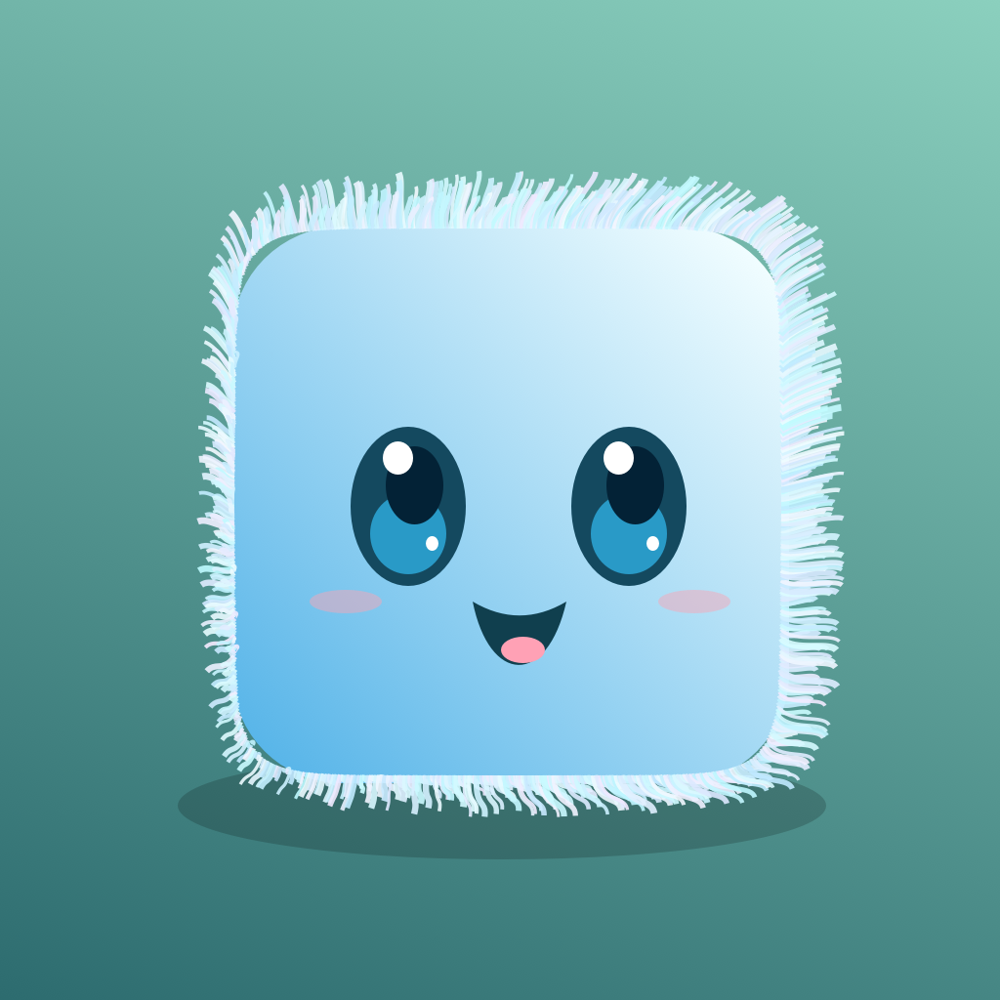

<h1 align="center">ElementalCube</h1>

<strong>Маленький куб. Большой мир.</strong> iPhone · iPad · Mac · ранняя альфа

**Физическая песочница с маленькими живыми стихиями.** Выбери первого друга или создай случайного, пройди семь этапов по выбранной ветке маршрута, развивай его навыки, выращивай и объединяй кубиков.

**Альфа 0.1.0 (16) доступна в TestFlight: внутренняя и внешняя группы, Apple APPROVED.** Тонкие границы воды, контактное замерзание, кирпичная кладка со связями и уточнённые экранные жесты. [Фактический статус Apple](docs/TESTFLIGHT.md) · [Установить альфу](https://testflight.apple.com/join/snm99FQh) · [Карточка](docs/APP_STORE_CARD.md).

## Вода, лёд и кладка — обновление 16

В гротах можно выбить кирпич из настоящей подводной стенки: части без связи с основанием падают, сохраняют массу/происхождение и взаимодействуют с водой. Над стенкой есть путь для плавающих форм. У ящика остаются шесть физических частей; нехватка места в пуле не удаляет исходный предмет.

Вода проверяет весь путь частицы через тонкую преграду. Заморозка учитывает повёрнутые ящики, тонкие доски и берега; волна у ног не создаёт блоки вокруг сухого тела. Лёд ещё использует сегментированный фазовый меш; свободные куски льда и конденсация остаются впереди.

Длинный свайп на iPad тоже прыгает. Начало вертикального свайпа больше не успевает разогнать кубик к точке касания; тап и горизонтальное ведение продолжают задавать движение карты.

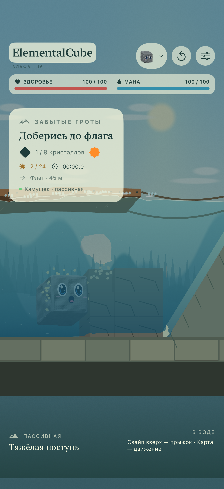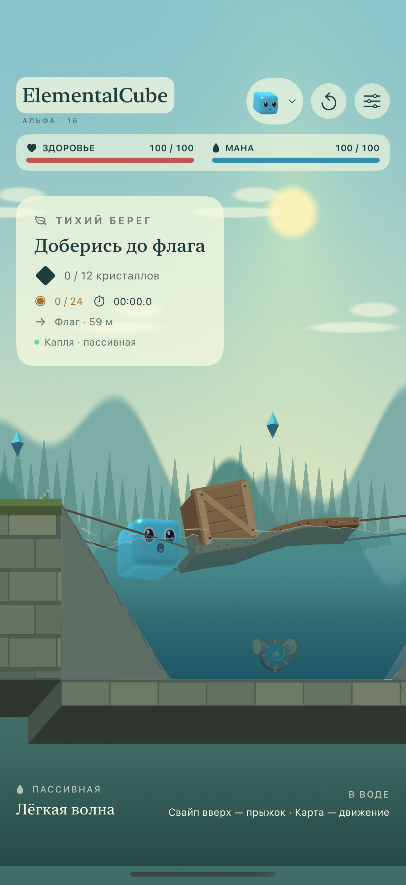

[Новые снимки](Previews/alpha16) · [Проверки 16 и границы модели](docs/QA-ALPHA16.md) · [Подтверждение выпуска](docs/releases/alpha16.json). Вода остаётся ограниченной 2D-моделью; полнота исходного ТЗ не объявляется достигнутой.

## Путь и разные движения — обновление 15

Семь связанных этапов с двумя ветками маршрута, экран результата, медали скорости, отдельные золотые монеты и точный учёт находок. Изученные навыки отмечены печатью и галочкой, их состояние видно и в описании. Талисманы получили отдельные [рисунки](docs/ITEM-ART.md); Сердце глубин доступно любой форме, которая доберётся до него, в том числе после испарения воды.

Капля сжимается перед маленьким физическим скачком и мягко расплющивается при посадке; Ветерок летит выше поверхности; огонь движется медленнее льда; Камушек разбивает предметы сильным столкновением. Улучшения движения теперь меняют собственный параметр стихии. Обломки имеют коллайдеры, массу и связь с водой. Полного разрушения зданий и замкнутого учёта сгоревшего вещества пока нет.

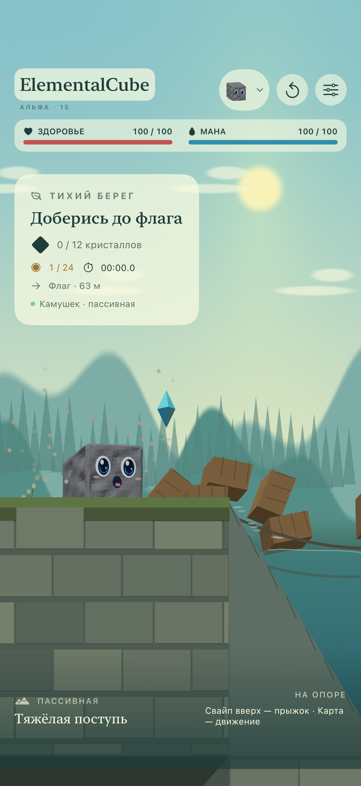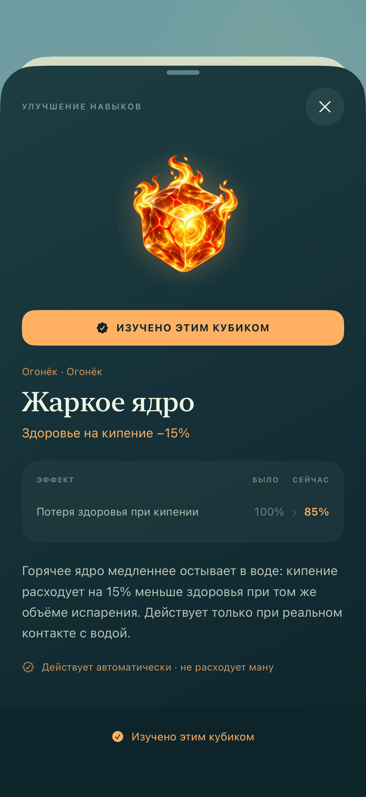

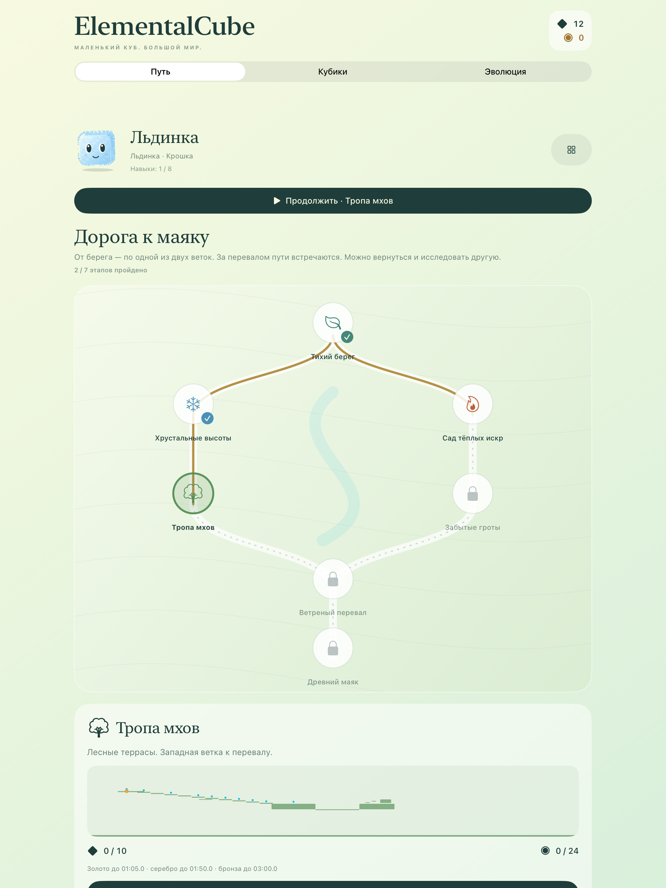

[Новые снимки](Previews/alpha15) · [Проверки 15 и ограничения](docs/QA-ALPHA15.md) · [Предметы и рисунки](docs/ITEM-ART.md).

## Возвращение к спецификации — обновление 14

[Сверка исходного ТЗ и всех 30 задач](docs/SPEC-AUDIT.md) показывает исполненные части, приближения и отсутствующие системы. Полный файл сохранён [без изменений](docs/SPECIFICATION-V2.txt). Обучаемого бота, локальных травм и серверной арены пока нет. Разрушаемые предметы и преграды появились в альфе 15; общего разрушения зданий ещё нет.

Слияние переработано: текущая форма отделена от родословной, 22 явных рецепта, ровно 2 из 4 карточек каждого источника. Подготовка показывает будущую форму, потери, вероятности и фиксаторы. Донор остаётся; прежнее поколение линии уходит в архив. Имущество не дублируется. Паспорт позволяет заранее выбрать четыре отпечатка, сохранённый отчёт доступен снова. Парик больше не замораживает воду, а следующее слияние с огнём возвращает обычного огненного кубика.

[Новые снимки](Previews/alpha14) · [Проверки 14](docs/QA-ALPHA14.md).

Это локальная реализация наследования существующих приёмов. Развитие пока представлено зачатками; полные заклинания, память и перенос поведения ещё впереди. [Правила и ограничения](docs/INVENTORY.md#мердж--правила-альфы-14).

## Навыки в обновлении 13

Две читаемые ветки: движение и стихия. Каждый узел показывает рисунок, краткий эффект, цену и доступность. Описание сравнивает реальные параметры до/после, объясняет применение и зависимости. Заблокированное улучшение можно рассмотреть, изучение отключено до выполнения условий. Очки списываются один раз, появляется подтверждение; прогресс принадлежит своему кубику.

Водное мастерство усиливает плавание и толчок, воздушный манёвр даёт руль в полёте. Завершающие навыки ускоряют высыхание Льдинки, лечат Каплю в воде, смягчают посадку Ветерка, усиливают качение Камушка и кипение Огонька. Гибриды имеют свои свойства. Пассивки и автоматические улучшения не тратят ману; обычный свайп-прыжок доступен сразу.

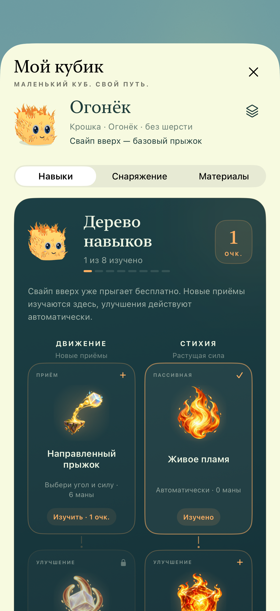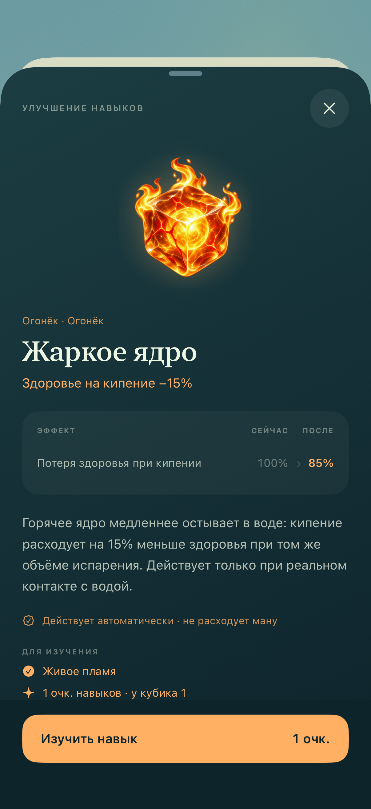

[Навыки и условия](docs/INVENTORY.md) · [20 иллюстраций и промпты](docs/SKILL-ART.md) · [Нативные снимки](Previews/alpha13) · [Проверки 13](docs/QA-ALPHA13.md).

## Вода в обновлении 12

Капля — гладкий куб из воды с мягкими углами, без шерсти, в меню и на карте. Обновлены перенос жидкости у предметов, выделение мелких капель и непрерывная поверхность; прозрачные пластины за волной удалены. Испарение забирает реальный объём вокруг источника и не оставляет ложных ячеек давления. [Разбор и источники](docs/PHYSICS.md#сборка-12-поверхность-и-перенос-воды) · [Проверки 12](docs/QA-ALPHA12.md) · [Нативные снимки](Previews/alpha12).

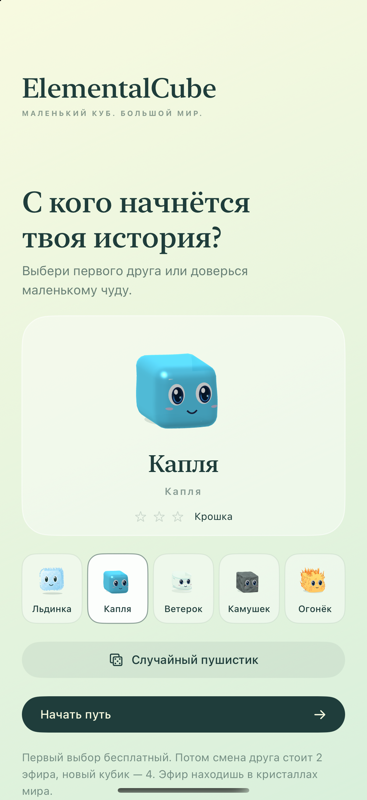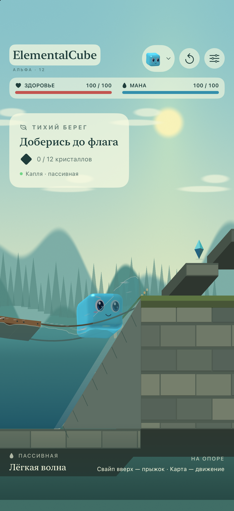

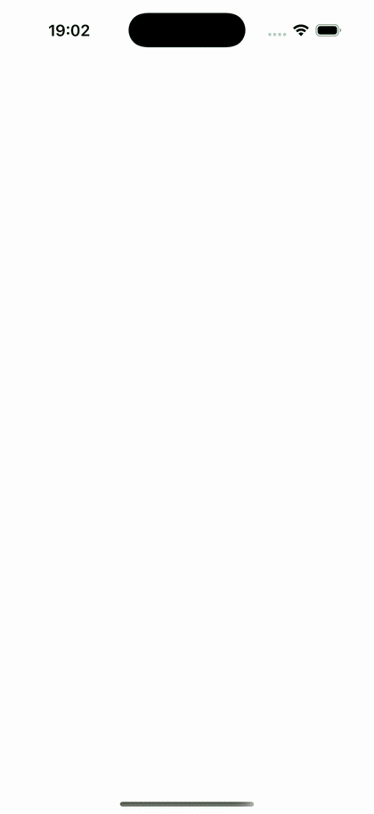

## Как играть

- **Свайп вверх по игровому экрану** — бесплатный базовый прыжок. Небольшой наклон слегка направляет его.
- **Касание или движение пальцем по карте** — кубик движется к выбранной точке; новое касание меняет направление.
- **Касание и поглаживание кубика** — радость, мимика и сердечки.
- **Удержание кубика и перетягивание** — прицельный прыжок, только после изучения. Начальный предел 8 м/с (у воздуха 8,4), усиления открываются в личном дереве. Траекторию показывает пунктир без стрелки.
- **Повторный свайп в воздухе** — один дополнительный толчок, если изучен двойной прыжок.

В начале известна только пассивка. Она всегда бесплатна и уже занимает свой слот. Базовый прыжок не требует изучения. Направленный прыжок расходует 6 маны, воздушный толчок — 10; мана восстанавливается. На Mac работают те же жесты мышью, стрелки/A–D и пробел.

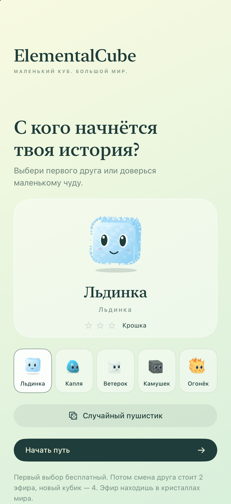
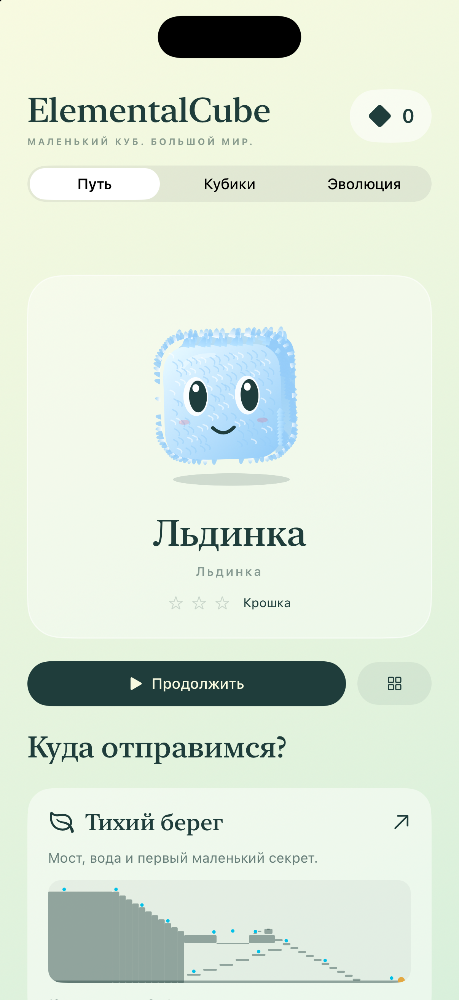
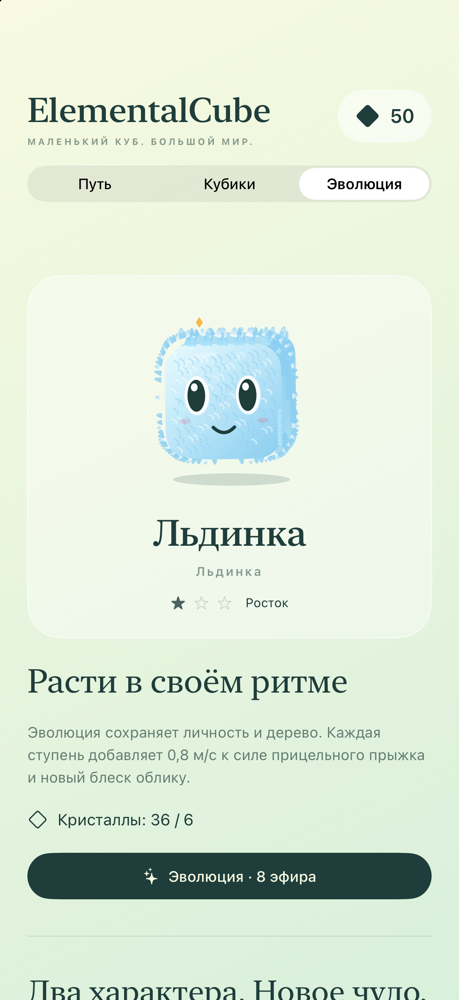

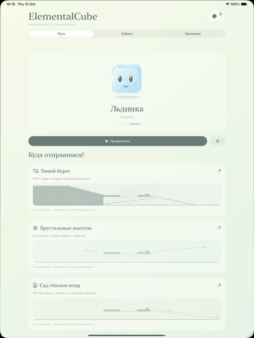

## Пять стихий и свои движения

| Кубик | Движение и пассивка |
| --- | --- |
| Льдинка | Скользит с коротким морозным следом. Вода сразу становится опорой, затем лёд постепенно растёт в стороны и вниз. |
| Капля | Подпрыгивает маленькими скачками, плавает и физически сплющивается для прохода вдвое ниже обычного кубика. После выхода распрямляется; масса сохраняется. |
| Ветерок | Летит примерно в 1,28 м над опорой, дольше держится в воздухе и управляется в полёте с рождения. |
| Камушек | Катится настоящим вращением тела, тонет, проходит по дну. Сильным ударом разбивает ящик и разрешённые преграды на физические обломки. |
| Огонёк | Вязко перетекает медленнее Льдинки, быстро гасит инерцию, сжигает траву и дерево, оставляет обугленный след. Испаряет воду за здоровье. |

Кубики дышат, моргают, смотрят по сторонам, радуются поглаживанию и находкам. Шерсть есть у ледяного тела: на передней грани и контуре она реагирует на ветер, намокание, движение и посадку. Вода — гладкий округлый куб без шерсти, воздух окружён завихрениями, огонь покрыт изогнутыми язычками по всему телу. Мягкий голубой портрет Льдинки сохранён. Для остальных стихий меню использует объёмную модель и соответствующие материалы. Камень и огонь невосприимчивы к огню; остальные формы могут загореться и потушиться в воде. Живые портреты работают и при остановленной игре.

## Друзья, навыки и эволюция

Первый выбор бесплатный: пять стихий или случайное имя и облик. После начала смена уже имеющегося друга стоит **2 эфира**, новый — **4**. Каждый кристалл мира приносит эфир один раз для всего профиля; первое прохождение каждой карты — ещё **6**. Перезапуск не создаёт валюту повторно.

У каждого кубика собственные находки, дерево, талисман и материалы. За первую личную находку кристалла он получает очко навыка. Эволюция имеет три ступени: нужны 3/6/9 разных находок и 4/8/12 эфира. Личность и изученные навыки сохраняются, внешность и предел прицельного прыжка растут.

**Слияние стоит 4 эфира.** Оно меняет поколение выбранной линии, а донор остаётся. Из каждой четвёрки умений выбираются ровно две карточки каждого источника; отдельно отбирается блок развития, пока нераскрытый. Предпросмотр объясняет форму, потери и фиксаторы, результат сохраняется без повторного розыгрыша. Прежнее поколение остаётся только в родословной. Вода + огонь дают Парика; Парик + огонь — Огонька без возврата утраченных ветвей.

[Инвентарь и правила наследования](docs/INVENTORY.md) · [Анимация](docs/AVATARS.md).

## Путешествие с развилками

Семь этапов соединены на большой карте маршрута: **Тихий берег → Хрустальные высоты → Тропа мхов** или **Тихий берег → Сад тёплых искр → Забытые гроты**. Обе ветки ведут на **Ветреный перевал**, затем к **Древнему маяку**. Прохождение открывает следующий участок; к другой ветке можно вернуться. Это карта выбора связанных этапов, без бесшовной загрузки общего физического мира.

Участки различаются геометрией, точкой начала, направлением пути, ветром и фоном. Границы каждого — 112 × 52 м. Точные количества кристаллов: **12 / 12 / 12 / 10 / 9 / 11 / 8**. Уже найденные предметы скрываются после перезапуска; очки и валюта не дублируются. Монетки — отдельные золотые находки, общие для профиля. За 30 монет можно купить очко навыка выбранному кубику.

Финиш показывает время, находки и награды. Первый финиш этапа даёт 6 эфира и 10 монет. Скорость приносит 5/12/20 монет за бронзу/серебро/золото; при улучшении выдаётся только разница. Повтор медали не приносит новую награду. Время считается с первого движения в симуляции, меню останавливает его. Изменённая физика разрешает финиш и находки, но не рекорд скорости. Это локальные результаты, без соревновательной защиты от изменения сохранения.

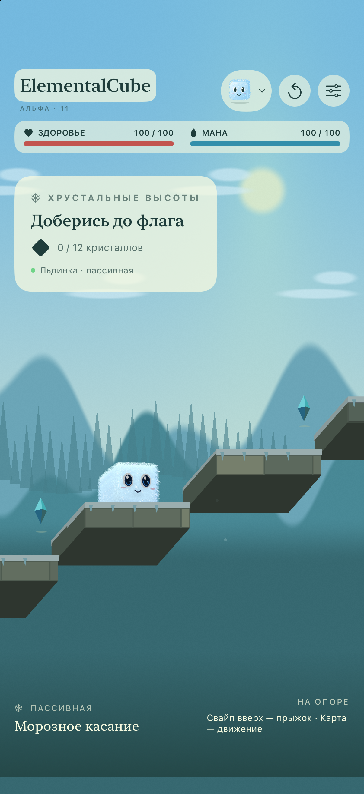
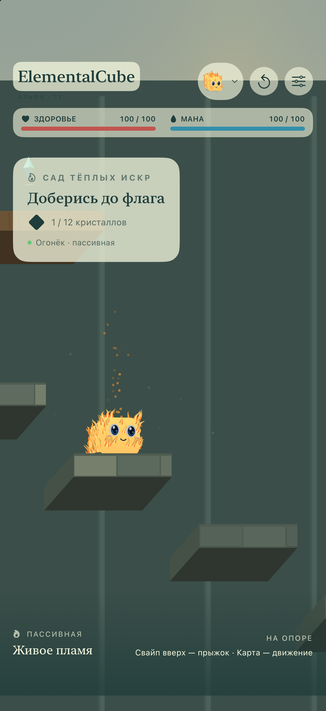

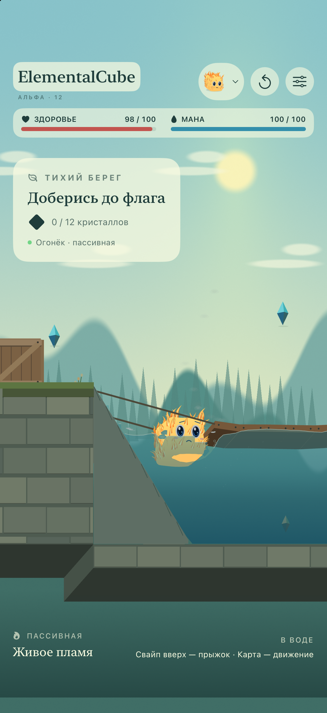

## Физика

Box2D 3.1.1 считает столкновения, массу, вращение ящика, шарниры и тросы моста на 120 Гц. PIC/FLIP-жидкость обменивается импульсом с телами; капли брызг несут часть воды и возвращаются в водоём, пена следует течению. Лёд забирает массу из воды, растёт постепенно и возвращает её без старого импульса при таянии. Толстая корка живёт дольше тонкой. Огонь поджигает только траву и дерево при контакте, оставляя постепенное обугливание самих поверхностей. В воде появляются локальные пузырьки, пар и циркуляция; кипение не начинается при пролёте над прудом.

Это игровая модель в плоскости XY с объёмным изображением. Полная трёхмерная жидкость, свободные ледяные обломки и точная термодинамика не моделируются. [Подробности и ограничения](docs/PHYSICS.md) · [Проверки обновления 12](docs/QA-ALPHA12.md).

## Запустить

На Mac: `./scripts/run-mac.sh`. На iPhone/iPad: открой `ElementalCube.xcodeproj`, схема `ElementalCube-iOS`. [Разработка](docs/DEVELOPMENT.md).

Игра работает без регистрации, рекламы, покупок и игрового сервера. Настройки, коллекция, валюта, навыки и предметы сохраняются на устройстве. [Конфиденциальность](docs/PRIVACY.md). CI/CD не используется; сборки и публикация запускаются локально. [Архив альфы 9](Previews/alpha9).

## Лицензия

**Copyright (c) 2026 Sergii Ziborov. All rights reserved.** Собственный код и материалы под [закрытой лицензией](LICENSE): публичный доступ не даёт разрешения на использование, изменение и распространение без письменного разрешения правообладателя. Просмотр и форки внутри GitHub регулируются условиями сервиса.

Box2D сохраняет MIT. [Сторонние компоненты](THIRD_PARTY_NOTICES.md).
