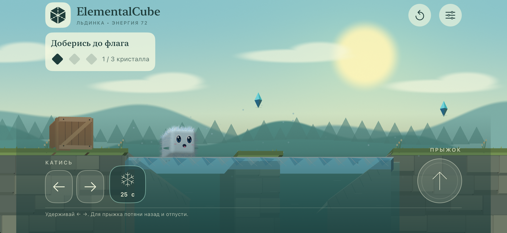
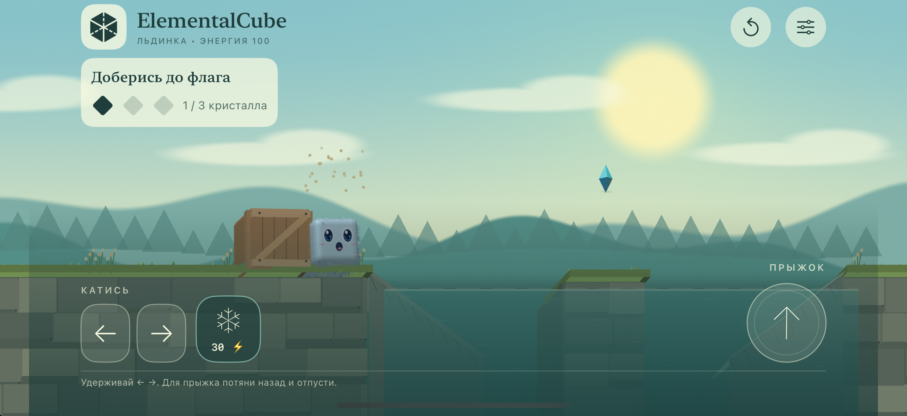
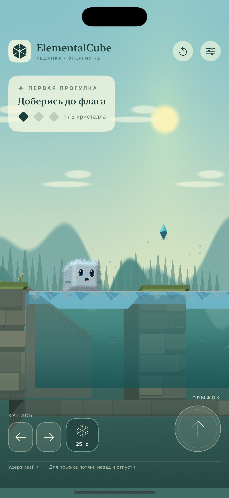
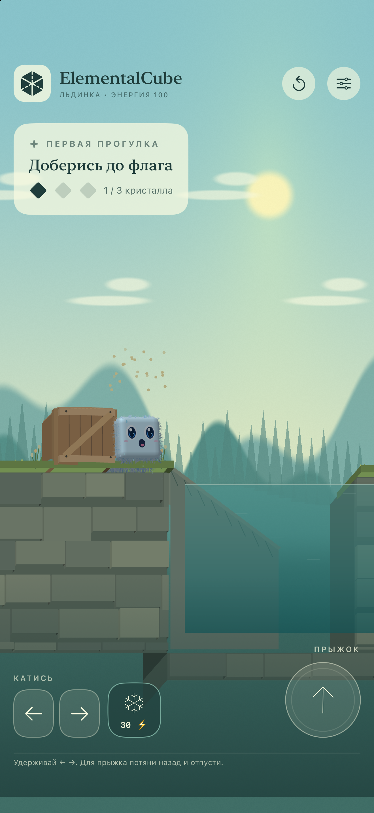
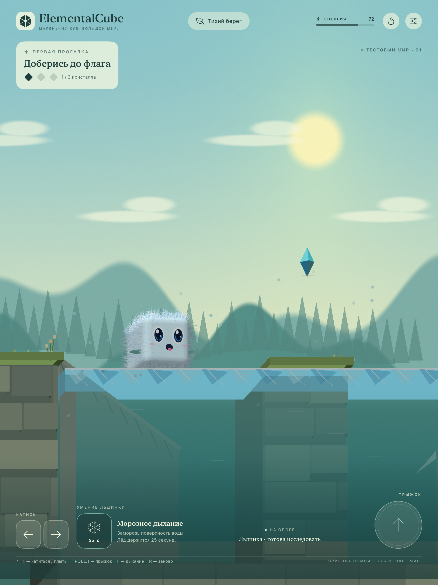

  

<h1 align="center">ElementalCube</h1>

<strong>Маленький куб. Большой мир.</strong>

iPhone · iPad · Mac · ранняя альфа

Познакомьтесь с **Льдинкой** — любопытным пушистым кубиком. Его первое приключение проходит на тихом берегу: добраться до флага, собрать три кристалла, переплыть воду и попробовать превратить её в ледяную дорожку.

Потяните и отпустите, чтобы прыгнуть по выбранной дуге. Катитесь по траве, толкайте деревянный ящик и скользите по льду. Кубик сосредотачивается, радуется находкам, хмурится в воде и встряхивает мокрую шерсть.

**Альфа 0.1.0 (2) собрана и подписана для iPhone и iPad.** Загрузка в TestFlight ожидает создания карточки приложения в App Store Connect. Игра работает без регистрации, рекламы и игрового сервера.

[Материалы для карточки Apple](docs/APP_STORE_CARD.md) · [Скриншоты в полном размере](Previews/app-store) · [Конфиденциальность](docs/PRIVACY.md)

## Первый берег

Морозное дыхание создаёт наст на 25 секунд. Твёрдая поверхность действительно поддерживает кубика и ящик; на ней сохраняется скольжение. Если заморозить воду, уже находясь в ней, вокруг кубика остаётся отверстие для выхода.

В воде кубик намокает: шерсть темнеет, слипается и тяжелеет. До берега можно доплыть или оттолкнуться кнопкой прыжка. На суше Льдинка постепенно высыхает и встряхивается.

## На iPhone и iPad

Снимки ниже сделаны в симуляторах из сборки 0.1.0 (2). Полные PNG подходят для соответствующих разделов скриншотов App Store Connect.

  
  

## Что уже можно почувствовать

- **Прыжок и инерция.** Направление и сила задаются жестом; пунктирная дуга показывает будущий полёт. Короткое касание — прыжок вверх.
- **Качение и плавание.** Удерживайте стрелки, чтобы катиться или двигаться в воде. Ящик можно толкать; вода поддерживает оба тела.
- **Разные поверхности.** Трава смягчает посадку, камень встречает жёстче, лёд позволяет скользить. На поддерживаемых iPhone ощущения дополняет вибрация.
- **Кубик с характером.** Мимика, моргание, взгляд, сжатие перед прыжком, мокрая шерсть и капли после воды.
- **Удобные настройки.** Сила прыжка, гравитация, масштаб камеры, прямое прицеливание или рогатка и вибрация сохраняются между запусками.
- **Обе ориентации.** Портретный и горизонтальный режимы на iPhone и iPad; незавершённый жест отменяется при повороте или уходе в фон.

## Управление

| Действие | iPhone / iPad | Mac |
| --- | --- | --- |
| Катиться или плыть | Удерживать ← / → | ← / → или A / D |
| Прыгнуть вверх / оттолкнуться в воде | Коротко коснуться кнопки прыжка | Пробел |
| Направленный прыжок | Потянуть кнопку назад и отпустить | Потянуть мышью и отпустить |
| Морозное дыхание | Кнопка снежинки, 30 энергии | F |
| Начать карту заново | Кнопка перезапуска | R |
| Пауза | При уходе в фон | Esc |

В настройках можно переключить жест с рогатки на прямое прицеливание. В воздухе дополнительного прыжка нет; толчок в воде доступен без твёрдой опоры.

## Для создания карточки Apple

Откройте **App Store Connect → Apps → + → New App**.

| Поле | Значение |
| --- | --- |
| Platform | iOS — одно приложение для iPhone и iPad |
| Name | `ElementalCube` |
| Primary language | Russian |
| Bundle ID | `com.weavatrix.elementalcube` |
| SKU | `ElementalCube-iOS` |
| User Access | Full Access |
| Версия после создания | `0.1.0` |
| Категория | Games → Puzzle / Adventure |

[Описание, подзаголовки и задания тестерам — готово для копирования](docs/APP_STORE_CARD.md). [Иконка 1024 × 1024](Resources/Assets.xcassets/AppIcon.appiconset/AppIcon.png). [PNG для iPhone 6.9″ и iPad 13″](Previews/app-store).

## Куда развивается игра

Ручное управление и реакция мира — первый этап. Затем появятся обучение кубика собственным приёмам, новые физические задачи, формы, рискованная эволюция и арены. Сейчас доступны **одна карта и одна форма**; обучение, эволюция, арены и сохранение прохождения ещё не реализованы.

Вода пока использует пружинную поверхность, плавучесть и сопротивление. Шерсть состоит из процедурных геометрических прядей. Качество, FPS и тактильный отклик на физическом iPhone ещё требуют проверки.

## Запустить и проверить

На Mac: `./scripts/run-mac.sh`. Для iPhone и iPad откройте `ElementalCube.xcodeproj` и выберите схему `ElementalCube-iOS`.

[Сборка и устройство проекта](docs/DEVELOPMENT.md) · [Подготовка TestFlight](docs/TESTFLIGHT.md)

CI/CD нет. Сборки и проверки запускаются локально.

## Лицензия

**Copyright (c) 2026 Sergii Ziborov. All rights reserved.** Собственный код и материалы игры распространяются под [закрытой лицензией](LICENSE); публичный доступ не даёт разрешения на их использование, изменение и распространение без письменного разрешения правообладателя. Просмотр и форки внутри GitHub регулируются условиями сервиса.

Box2D сохраняет лицензию MIT. [Сторонние компоненты](THIRD_PARTY_NOTICES.md).
